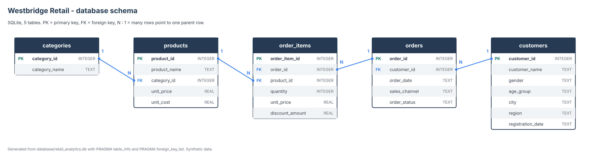
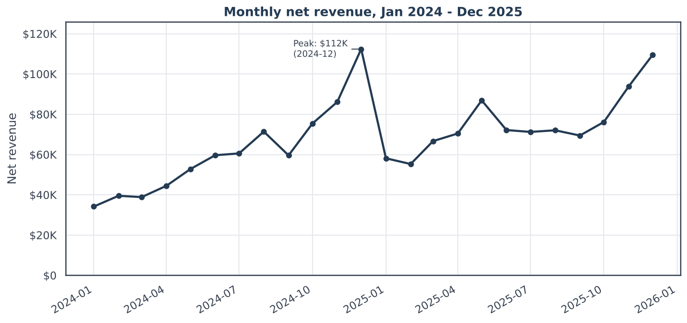
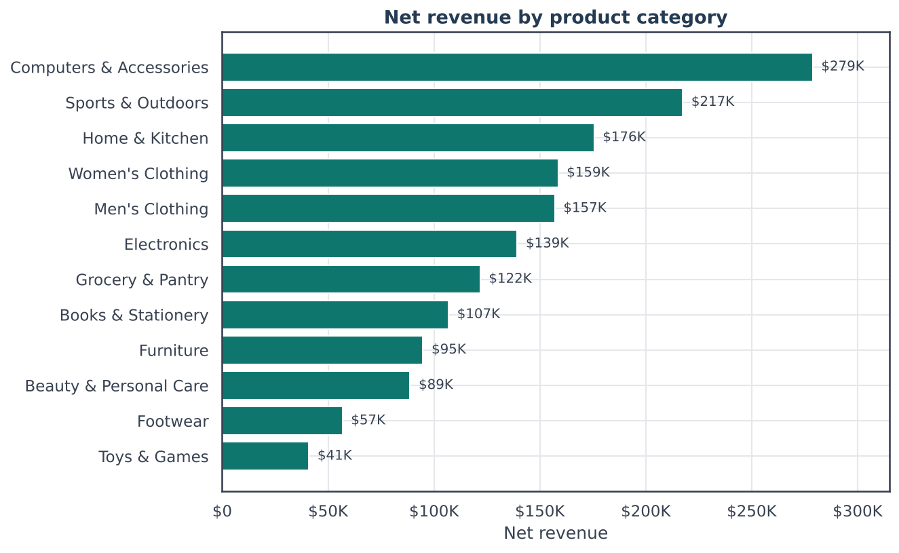
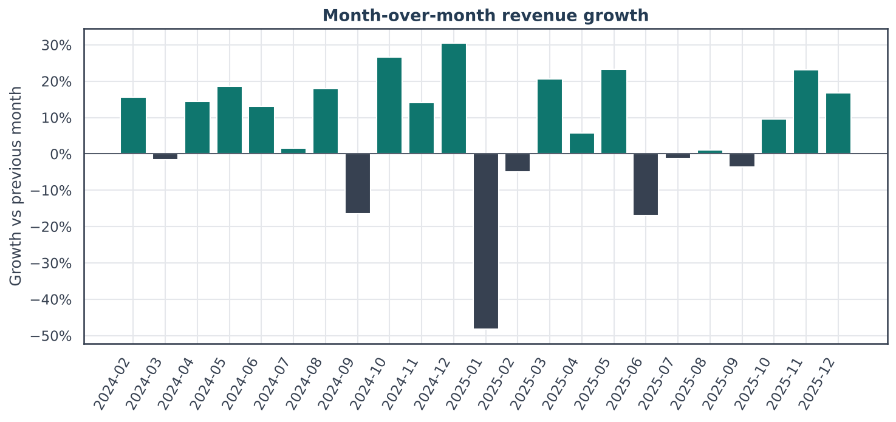
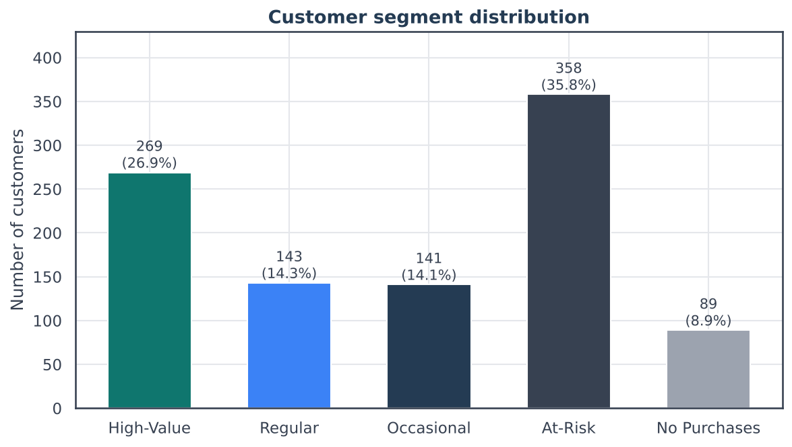

# Retail Sales & Customer Analytics | SQL + Python

A portfolio project that analyses sales, products and customers for **Westbridge Retail**, a fictional retailer with physical stores and an online channel. Raw CSV files are loaded into a SQLite database, queried with SQL, pulled into pandas, and presented in a Jupyter notebook with charts and written findings.

**All data is synthetic.** See [Data source and synthetic-data disclosure](#18-data-source-and-synthetic-data-disclosure).

Workflow: `CSV files -> SQLite database -> SQL queries -> pandas DataFrames -> Jupyter charts -> findings`

## Business questions

1. How much revenue does the company earn, and how does it vary by month, channel and region?
2. Which products and categories drive revenue and gross profit?
3. How many customers buy once, and how many come back?
4. Who are the most valuable customers, and who is drifting away?

## Dataset overview

Orders span January 2024 to December 2025 and are generated by `scripts/generate_data.py` (fixed seed `42`, so the files are reproducible).

| Table | Rows | What it holds |
|---|---:|---|
| `customers` | 1,000 | name, gender, age group, city, region, registration date (5 regions) |
| `categories` | 12 | product categories |
| `products` | 100 | name, category, unit price, unit cost |
| `orders` | 15,000 | customer, date, sales channel (Online / In-Store), status (Completed / Cancelled) |
| `order_items` | 29,742 | product, quantity, unit price, discount amount per order line |

Business logic built into the generator: customers differ in purchase frequency (some buy once, some often, some never), some customers stop buying part-way through, orders never precede registration, sales peak in November/December, categories differ in price range and margin, a few categories grow while others fade, and cancellations are more common online. Cancelled orders stay in the database and are excluded from sales KPIs.

## Database schema



Primary keys, foreign keys (enforced with `PRAGMA foreign_keys = ON`), `NOT NULL` constraints and `CHECK` constraints (for example `discount_amount <= quantity * unit_price` and `unit_cost < unit_price`) are defined in [`sql/01_create_tables.sql`](sql/01_create_tables.sql). The diagram is drawn from the database itself by `scripts/draw_schema_diagram.py`.

## Tools used

Python 3.11+, SQLite, SQL, pandas, NumPy, Matplotlib, Seaborn, Jupyter Notebook, GitHub Codespaces (dev container included).

## SQL techniques demonstrated

- `INNER JOIN` across up to five tables and `LEFT JOIN` to keep customers or products with no sales
- `GROUP BY`, `HAVING` and aggregate functions
- Date functions: `STRFTIME`, `DATE`, `JULIANDAY`
- Common table expressions, including a recursive calendar CTE
- Window functions: `LAG` (month-over-month, year-over-year, days between orders), `ROW_NUMBER`, `RANK`, `NTILE`, `SUM() OVER ()` for shares
- `CASE` expressions and conditional aggregation (`SUM(CASE WHEN ...)`)
- Scalar and correlated subqueries

Queries are grouped in `sql/analysis/` (each query starts with a `-- name:` marker and a comment stating the business question).

| File | Topics |
|---|---|
| `01_sales_performance.sql` | KPIs, monthly revenue, channel, region, cancellations |
| `02_product_performance.sql` | top products, categories, gross profit and margin, low-activity products |
| `03_customer_behavior.sql` | repeat vs one-time customers, spend per customer, frequency bands, customers without purchases |
| `04_monthly_growth.sql` | month-over-month and year-over-year growth with `LAG` |
| `05_customer_segmentation.sql` | RFM scores and documented segment rules |
| `06_advanced_queries.sql` | best product per category, top categories per region, channel mix, repurchase interval, first-channel retention, discount impact |

Definitions: line revenue = `quantity * unit_price - discount_amount`; line gross profit = line revenue - `quantity * unit_cost`. **Gross profit is not net profit**: the data has no operating expenses.

## Analysis workflow

1. `scripts/generate_data.py` writes the five CSV files to `data/raw/`.
2. `scripts/load_database.py` creates the schema and loads the CSVs into `database/retail_analytics.db`, then runs foreign key and integrity checks.
3. `src/database.py` opens connections (with foreign keys on), splits each SQL file into named queries and returns pandas DataFrames.
4. `src/analysis.py` validates query results, runs data-quality checks and prepares data for charts.
5. `notebooks/retail_business_analysis.ipynb` runs the SQL scripts, inspects the data, draws eight charts, and states findings and recommendations. The notebook reuses the SQL files instead of rewriting the calculations in pandas.

## Selected charts

| | |
|---|---|
|  |  |
|  |  |

All eight charts are in [`assets/charts/`](assets/charts/).

## Key findings from the executed queries

Figures below come from the SQL queries on the generated database (completed orders only).

- **Overall:** $1,636,820.53 net revenue from 14,272 completed orders, 39,590 units sold, average order value $114.69. Discounts totalled $54,008.07. Gross profit was $606,266.47 (37.0% gross margin).
- **Growth:** revenue was $735,077 in 2024 and $901,744 in 2025 (+22.7%).
- **Seasonality:** November and December made up 27.0% of 2024 revenue and 22.5% of 2025 revenue. The highest month was 2024-12 ($112,399) and revenue fell 48.3% from December 2024 to January 2025.
- **Channels:** in-store 54.9% of revenue, online 45.1%. Average order value is almost the same ($114.91 in-store, $114.41 online). 728 of 15,000 orders (4.9%) were cancelled: 7.0% online vs 3.0% in-store.
- **Regions:** Northeast is the largest ($379,864, 23.2%) and Southwest the smallest ($277,232, 16.9%).
- **Categories:** Computers & Accessories leads on revenue (17.0%) but has a 16.9% gross margin, the lowest of the 12 categories. Beauty & Personal Care has the highest margin (58.0%).
- **Products:** the top 10 products bring in 39.3% of revenue. The single top product, Ultrabook 14-inch Laptop, earned $181,978. The slowest seller, Chef's Knife 8-inch, sold 5 units in two years.
- **Customers:** 1,000 registered, 911 with a completed purchase, 89 without. Of the buyers, 118 bought once and 793 (87.0%) bought two or more times. Average spend is $1,796.73 per buying customer (median $971.46); buyers have a median of 9 orders.
- **RFM segments** (reference date 2025-12-31): High-Value 269 customers (26.9%) produce 66.1% of revenue; At-Risk 358 customers (35.8%, no purchase in the last 120 days of the data); Regular 143; Occasional 141; No Purchases 89.
- **Category trends 2025 vs 2024:** Women's Clothing +52.5%, Men's Clothing -10.4%.
- **Discounts:** 24.6% of order lines are discounted; they earn a 29.9% gross margin vs 39.1% for full-price lines. The product mix differs between the two groups, so this is a comparison and not proof that discounts alone cause the gap.
- **Repurchase timing:** among repeat customers, orders are on average 23.4 days apart.

## Business recommendations

1. Plan stock and staffing for November and December, and test promotions in the quietest months (January and February).
2. Review pricing and supplier cost in the lowest-margin categories (Computers & Accessories at 16.9%) before adding discounts there.
3. Run a win-back campaign for the 358 At-Risk customers, starting with the biggest past spenders.
4. Investigate online cancellations. The data has no cancellation reason, so start recording one.
5. Review the slowest-selling products and decide whether to promote, bundle or drop them.
6. Protect the High-Value segment with loyalty offers; it carries about 66% of revenue.

## Project structure

```
retail-sales-sql-python-analytics/
├── README.md
├── requirements.txt
├── .gitignore
├── LICENSE
├── .devcontainer/devcontainer.json
├── database/retail_analytics.db
├── data/raw/                     customers, products, categories, orders, order_items (.csv)
├── sql/
│   ├── 01_create_tables.sql
│   └── analysis/                 01_sales_performance ... 06_advanced_queries (.sql)
├── scripts/
│   ├── generate_data.py          create the synthetic CSV files
│   ├── load_database.py          build the SQLite database
│   ├── draw_schema_diagram.py    draw assets/database_schema.png from the database
│   └── validate_project.py       run the project checks
├── src/
│   ├── database.py               connections and SQL file helpers
│   └── analysis.py               validation and data-quality helpers
├── notebooks/retail_business_analysis.ipynb
├── assets/
│   ├── database_schema.png
│   └── charts/                   8 PNG charts
└── reports/business_analysis_report.html
```

There is no `sql/02_load_data.sql`: loading is done in Python (`scripts/load_database.py`) with pandas, which avoids SQLite command-line `.import` differences between systems.

## Setup instructions

Requires Python 3.11 or newer. From the repository root:

```bash
python -m pip install -r requirements.txt
python scripts/load_database.py
jupyter lab
```

The database file is already included, so `load_database.py` is only needed if you want to rebuild it.

## GitHub Codespaces instructions

1. On GitHub, choose **Code > Codespaces > Create codespace on main**.
2. The dev container uses Python 3.11 and runs `pip install -r requirements.txt` and `python scripts/load_database.py` automatically.
3. Open `notebooks/retail_business_analysis.ipynb` in the editor (the Jupyter extension is preinstalled), choose the Python 3 kernel, and select **Run All**.
4. To use JupyterLab in the browser instead, run `jupyter lab --ip=0.0.0.0 --no-browser` in the terminal. Open the **Ports** tab, find port `8888` and click the globe icon (**Open in Browser**). If Jupyter asks for a token, copy it from the terminal output.

## How to run the notebooks

Open `notebooks/retail_business_analysis.ipynb` and run all cells. The first code cell locates the repository root itself, so it works whether Jupyter was started in the root folder or in `notebooks/`. Charts are saved to `assets/charts/` each time.

To run it from the command line:

```bash
jupyter nbconvert --to notebook --execute --inplace notebooks/retail_business_analysis.ipynb
```

## How to rebuild the database

```bash
python scripts/generate_data.py      # optional: recreate the CSV files (same seed, same data)
python scripts/load_database.py      # drop and recreate all tables, then load the CSVs
python scripts/draw_schema_diagram.py  # optional: redraw the schema diagram
python scripts/validate_project.py   # run the checks
```

`load_database.py` always starts from a clean schema (the SQL file drops and recreates every table), so running it repeatedly never produces duplicate rows. If you change the generator, the figures in this README and in the notebook text will change; the notebook findings are generated from the query results, but the README figures would need to be updated by hand.

## Limitations

- The data is synthetic. Patterns such as seasonality, churn and category trends were put there by the generator, so the findings describe this dataset only.
- Only gross profit can be calculated. There are no operating costs, shipping, returns or taxes.
- 15,000 orders across 1,000 customers means buyers average about 16 completed orders each, higher than typical for many retailers, so repeat rates are high.
- Order-line prices equal list prices, and orders are only Completed or Cancelled (no returns or refunds).
- The RFM segment rules (120-day At-Risk cutoff, quintile scores) are judgement calls. `NTILE` splits tied values arbitrarily; customer ID is used as the tie-breaker.
- Differences between channels, regions and segments are descriptive and were not tested for statistical significance.
- The Codespaces configuration was written to standard dev container settings but was not run inside GitHub Codespaces while building this project.

## Data source and synthetic-data disclosure

Every record in `data/raw/` and `database/retail_analytics.db` was generated by `scripts/generate_data.py`. Westbridge Retail, its customers, products and orders are fictional. Customer names are random combinations of common first and last names, and any resemblance to real people is coincidental. City names are real places used only as labels. No real company data, personal data or external data source was used.
